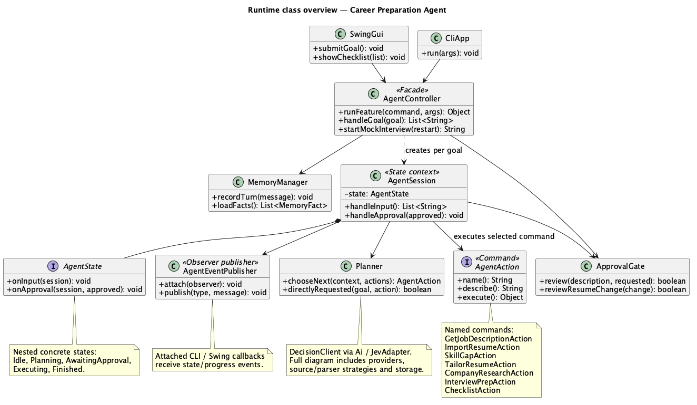

# Career Preparation AI Agent

**EECS3311 — Stage 2: AI–Human Collaborative Implementation**
Repository: <https://github.com/AmirrezaN8/EECS3311>

A Java desktop and command-line application that helps new graduates prepare job applications in Canada and the United States. It imports job postings and resumes, remembers career facts, identifies skill gaps, proposes reviewed resume edits, researches employers, prepares interview questions, conducts typed mock interviews and saves preparation checklists.

Swing and the CLI share an [`AgentController`](src/main/java/career/AgentController.java). Jev makes constrained decisions; Claude generates and reasons over supplied evidence. The preparation agent chooses actions, requests approval for proposed work, uses tools and memory, and saves results in SQLite.

## Start here: submission materials

| Required material | Location | Current evidence |
|---|---|---|
| Stage 2 implementation report | [stage2-report.pdf](stage2-report.pdf) · [editable source](docs/stage2-report.md) | Current report and PDF include implementation/history evidence and rendered diagrams; missing evidence is explicitly marked. |
| Feature demonstrations | [Feature index and timestamps](docs/demo-guide.md) · [YouTube playlist](https://www.youtube.com/playlist?list=PLWFiN1jmW3sI) | F01–F10 links are available; all ten recordings are accessible. F10 shows requested gap/checklist execution. Review findings are in the index. |
| Java application and tests | [Production source](src/main/java/career) · [Tests](src/test/java/career) | F01–F10 paths; clean offline build passes 480 assertions. |
| Implemented UML | [Class overview](docs/implemented-class-overview.png) · [Full class diagram](docs/implemented-class-diagram.svg) · [Use cases](docs/implemented-use-cases.png) · [Sequence](docs/implemented-sequence.svg) | Current code reconciled; PNG/SVG images and editable PlantUML sources supplied. Images are included in the refreshed report PDF. |
| AI development collaboration | [Report section 5](docs/stage2-report.md#5-ai-tools-and-collaboration-log) | Tools/tasks, interactions and reported runtime tokens/costs recorded; development-session tokens and exact Jev cost remain unreported. |
| Development and verification | [Verification record](docs/verification.md) · [Git history](https://github.com/AmirrezaN8/EECS3311/commits/main) · [Weekly summary below](#weekly-git-activity) | Offline checks pass; remaining external/packaged checks are distinguished from successes. |
| Original Stage 1 design | [Stage1.md](Stage1.md) · [uml.uxf](uml.uxf) | Original files preserved unchanged. |
| Reproduction inputs | [pom.xml](pom.xml) · [build script](scripts/build.sh) · [safe configuration](career.properties.example) · [fictional samples](samples/README.md) | No credentials or personal databases are required to build or run offline checks. |

I recorded the supplementary demos after the deadline. If late evidence can be considered, I would appreciate your reviewing the updated clips, including the GUI-to-CLI demonstration. [Supplementary Stage 2 demo playlist](https://www.youtube.com/playlist?list=PLTA01MSBttJc)

**Final submission items still open:** video explanation/coverage findings, remaining development-session/exact-cost accounting, dependency-backed PDF/legacy Word verification. The current report is a working artifact, not a claim that these items are complete. Final documentation must be committed and pushed before submitting the repository URL.

## Prerequisites

The tested environment is **macOS with Temurin JDK 27**, compiling Java 21-compatible code. Other operating systems have not been verified.

| Dependency | Needed for |
|---|---|
| JDK 21 or newer (`java`, `javac`, `jar`) | Compilation and execution; a JRE alone is insufficient. |
| `sqlite3` executable on `PATH` | Local persistence and offline tests; the repositories use the SQLite CLI rather than JDBC. |
| Desktop display | Swing GUI; CLI works without a desktop. |
| Maven | Dependency-backed package, JUnit, PDFBox and legacy Word support. Optional for the offline build. |
| Internet and provider credentials | AI features, Adzuna job lookup and Brave company research. Not needed by offline tests. |

If dependencies are missing and you use [Homebrew](https://brew.sh), install the required packages:

```sh
brew install openjdk@21 sqlite
# Optional, for the dependency-backed package:
brew install maven
```

For a Homebrew JDK that is not selected by your shell:

```sh
export JAVA_HOME="$(brew --prefix openjdk@21)/libexec/openjdk.jdk/Contents/Home"
export PATH="$JAVA_HOME/bin:$PATH"
```

Installation references: [OpenJDK 21](https://formulae.brew.sh/formula/openjdk@21), [SQLite](https://formulae.brew.sh/formula/sqlite), [Maven](https://formulae.brew.sh/formula/maven).

Check your tools:

```sh
java -version
javac -version
sqlite3 --version
# When using Maven:
mvn -version
```

## Clone, build and verify without API keys

```sh
git clone https://github.com/AmirrezaN8/EECS3311.git
cd EECS3311
sh scripts/build.sh
java -jar target/career-agent.jar help
```

The script compiles production/test sources with `--release 21`, creates `target/career-agent.jar`, and runs the offline assertion suite. It uses test-only model/tool fixtures and disposable databases: **no live AI requests, provider charges or real user database changes**.

A clean tracked snapshot passed **480 assertions** on November 15, 2026. The script explicitly reports skipped dependency-backed PDF and valid binary Word checks when their dependencies/sample are unavailable. A skip is not a successful integration check.

### Dependency-backed package

```sh
mvn package
java -jar target/career-agent-2.0.0.jar help
```

The Maven lifecycle runs the JUnit entry point and packages dependencies. [`pom.xml`](pom.xml) declares PDFBox 3.0.8, Apache POI 6.0.0 and JUnit Jupiter 5.11.4. The package is intended to support PDF and legacy `.doc` extraction; Maven/dependency resolution and those runtime paths have **not yet been verified in the final audit environment**. DOCX, Markdown, UTF-8 text and pasted resumes do not require these optional parser libraries.

## Configure AI and search locally

From the repository root:

```sh
cp -n career.properties.example career.properties
chmod 600 career.properties
```

Edit the ignored `career.properties` file and enter your own credentials. Do not commit it. Existing environment variables override properties; `.env` files are not loaded automatically.

| Setting | Purpose |
|---|---|
| `TYPESAFE_API_KEY` | Jev constrained decisions. Obtain through the [TypeSafe console](https://console.typesafe.ai). |
| `ANTHROPIC_API_KEY` | Claude generation/reasoning. Obtain through the [Claude console](https://platform.claude.com). |
| `ADZUNA_APP_ID`, `ADZUNA_APP_KEY` | F01 job search; pasted postings do not need these. |
| `BRAVE_SEARCH_API_KEY` | F06 live company research. |
| `CAREER_DATA` | SQLite path, default `data/career.db`. |

Models configured in the source:

| Role | Adapter | Model ID |
|---|---|---|
| Fixed-choice decisions | [`JevAdapter`](src/main/java/career/JevAdapter.java) | `jev-latest` |
| Generation/extraction | [`ClaudeAdapter`](src/main/java/career/ClaudeAdapter.java), `HAIKU` | `claude-haiku-4-5-20251001` |
| Reasoning | Same adapter, `SONNET` | `claude-sonnet-5-5` |

Relevant user text is sent to configured services when AI features are invoked. Providers may charge for requests. There is no fabricated-response or alternate-provider fallback. Generation/decision validation retries at most once before reporting failure; feature-specific recovery may retain raw input or prior saved results.

An optional live connectivity check uses nonpersonal input and **does call the providers**:

```sh
java -cp target/career-agent.jar career.ApiCheck all
```

It prints `PASS` or `NOT VERIFIED`; it is separate from offline testing. Do not display local keys in recordings.

## Launch the GUI or CLI

Run commands from the repository root so configuration and sample paths resolve correctly.

```sh
# Swing GUI:
java -jar target/career-agent.jar --gui

# Independent interactive CLI:
java -jar target/career-agent.jar

# A one-shot CLI command:
java -jar target/career-agent.jar job show
```

From the repository root, run the fictional posting task without keyboard input:

```sh
java -jar target/career-agent.jar -input samples/add-job.task
java -jar target/career-agent.jar job show
```

`-input <file>` executes one interactive CLI command on one UTF-8 line, using the same quoting and `@path` syntax. Relative paths resolve from the working directory. Approval requests receive the default decline and text requests receive empty input. Supply required inputs in advance. File, syntax and uncaught command errors exit nonzero. Use `help` or `--help` for commands, `--gui` for Swing, and no arguments for the interactive CLI. Model roles are configured separately through the environment or ignored `career.properties` as described above, so there is no per-invocation `-LLMAPI` switch.

For the Maven package, substitute `target/career-agent-2.0.0.jar` in these commands.

GUI navigation: **Job → Resume → Preparation**, with separate **My History**, **Mock Interview** and **Checklist** tabs. Work runs in a background worker; input/approval dialogs run on the Swing event thread. **Stop / cancel** interrupts active work while retaining completed saves.

In the interactive CLI, `help` lists operations and `exit` leaves the application. Quote arguments containing spaces. Approval requires entering `y`; empty/closed input declines. `@path` supplies a UTF-8 text file for posting/paste commands; `resume import PATH` selects the appropriate file parser.

## Example workflow with fictional data

Use a separate database to keep examples separate from real work:

```sh
export CAREER_DATA=data/reviewer-demo.db
java -jar target/career-agent.jar job add "Junior Java Developer" "Example Company" CA @samples/job-description.txt
java -jar target/career-agent.jar job show
```

These commands deterministically save/reload the sample posting and its explicit deadline without an AI call. After configuring providers, the following commands invoke real AI:

```sh
java -jar target/career-agent.jar resume import samples/resume.md
java -jar target/career-agent.jar gap
java -jar target/career-agent.jar tailor
java -jar target/career-agent.jar resume versions
java -jar target/career-agent.jar interview prep
```

Review each proposed resume edit. Decline the mock-interview offer if you only want to inspect the five generated questions. Then:

```sh
java -jar target/career-agent.jar results
java -jar target/career-agent.jar checklist show
java -jar target/career-agent.jar prepare "Run a fresh skill gap analysis, then build my preparation checklist using the saved job and resume"
```

Missing preparation work is offered with approval; declining leaves a useful partial checklist. For a mock interview, use `interview start`, then `interview answer "YOUR ANSWER"` for the displayed question. Follow-ups are optional and limited to one per base question. Completed interviews produce final feedback; `interview stop` saves progress and offers approved partial feedback. `interview restart` archives the previous attempt.

For company research, use a real company; Example Company is fictional. This separate example posting is **demo input, not an actual vacancy**:

```sh
java -jar target/career-agent.jar job add "Software Developer" "Microsoft" CA "FICTIONAL DEMO POSTING. Required skills: Java and SQL."
java -jar target/career-agent.jar company
```

Company research requires the Brave key. F01 live lookup is available through `job find "TITLE" "ACTUAL COMPANY" CA`; Adzuna results are labeled partial, and expanded/full estimates require separate approval. Finish with `unset CAREER_DATA` to return to the default database path in that terminal.

## Feature-to-code and demonstration map

Video numbering follows the author's upload order, oldest to newest, F01–F09. Each link starts its dedicated recording at **00:00**. See the [demonstration index](docs/demo-guide.md) for exact observed coverage and remaining evidence gaps.

| Feature | Main implementation | Demo |
|---|---|---|
| F01 — Job Description Intake | [`JobDescriptionIntake.getDescription()`](src/main/java/career/JobDescriptionIntake.java), source strategies and `GetJobDescriptionAction` | [F01](https://www.youtube.com/watch?v=qXdWoMGQRNM&t=0s) |
| F02 — Resume Import and Skill Extraction | [`ResumeImporter.importResume()/importText()`](src/main/java/career/ResumeImporter.java), parser factory/strategies and `ImportResumeAction` | [F02](https://www.youtube.com/watch?v=3hR3z8x4h0c&t=0s) |
| F03 — User History Memory | [`MemoryManager.recordTurn()`](src/main/java/career/MemoryManager.java), typed memory repository and history controls | [F03](https://www.youtube.com/watch?v=k6f0MA-zz0g&t=0s) |
| F04 — Skill-Gap Identification | [`SkillGapService.identify()`](src/main/java/career/SkillGapService.java), `SkillGapAction` and grouped assessments | [F04](https://www.youtube.com/watch?v=O3Qmxmvgtns&t=0s) |
| F05 — Resume Tailoring | [`ResumeTailorService.tailor()/safeChange()`](src/main/java/career/ResumeTailorService.java), per-edit approval and separate resume versions | [F05](https://www.youtube.com/watch?v=WQtftW-NVN8&t=0s) |
| F06 — Company Goals and Values Research | [`CompanyResearchService.research()`](src/main/java/career/CompanyResearchService.java), web-search tool, relevance filtering and citations | [F06](https://www.youtube.com/watch?v=r0O5peysyWs&t=0s) |
| F07 — Interview Question Preparation | [`InterviewPrepService.prepare()`](src/main/java/career/InterviewPrepService.java), exactly five validated questions and separate interview consent | [F07](https://www.youtube.com/watch?v=q5oq_tFzdRQ&t=0s) |
| F08 — Mock Interview with Feedback | [`MockInterviewService`](src/main/java/career/MockInterviewService.java), saved answers/follow-ups and final feedback | [F08](https://www.youtube.com/watch?v=PTBeonTQZ9A&t=0s) |
| F09 — Preparation Checklist | [`ChecklistService.build()/tick()`](src/main/java/career/ChecklistService.java), priorities, deadline and persisted progress | [F09](https://www.youtube.com/watch?v=mvviBAHe5yw&t=0s) |
| F10 — Prepare Me For This Job | [`AgentController.handleGoal()`](src/main/java/career/AgentController.java), [`Planner`](src/main/java/career/Planner.java) and [`AgentSession`](src/main/java/career/AgentSession.java) | [F10 — 00:00](https://www.youtube.com/watch?v=NZzGRP7kGIw&t=0s) |

All ten original features have connected implementation paths. Job selection, output/version inspection, direct fact entry, interview restart and untick support these workflows; they are not counted as extra features. Feature-specific changes, evidence limits and Stage 1 traceability belong in the [implementation report](docs/stage2-report.md).

## Implemented design patterns

| Pattern | Participating code and purpose |
|---|---|
| Facade | [`AgentController`](src/main/java/career/AgentController.java) coordinates shared GUI/CLI operations. |
| Command | [`AgentAction`](src/main/java/career/AgentAction.java) and seven named actions give the planner a common execution interface. |
| Strategy | [`JobDescriptionSource`](src/main/java/career/JobDescriptionSource.java) and [`ResumeParser`](src/main/java/career/ResumeParser.java) separate retrieval and format-specific behavior. |
| Factory | [`ResumeParserFactory`](src/main/java/career/ResumeParserFactory.java) chooses the parser without embedding file-type selection in the importer. |
| State | [`AgentSession.AgentState`](src/main/java/career/AgentSession.java) separates planning, approval, execution and completion. |
| Observer | [`AgentEventPublisher`](src/main/java/career/AgentEventPublisher.java) delivers progress to CLI/GUI callbacks. |
| Adapter | [`JevAdapter`](src/main/java/career/JevAdapter.java) and [`ClaudeAdapter`](src/main/java/career/ClaudeAdapter.java) translate external providers to application interfaces. |



The [full class diagram (SVG)](docs/implemented-class-diagram.svg) provides zoomable provider, command, strategy, storage and domain relationships; [PNG](docs/implemented-class-diagram.png) is also supplied. The report explains differences from Stage 1.

Editable sources: [overview](docs/implemented-class-overview.puml), [full class diagram](docs/implemented-class-diagram.puml), [use cases](docs/implemented-use-cases.puml), [sequence](docs/implemented-sequence.puml). Use cases and sequence also have [SVG](docs/implemented-use-cases.svg) and [PNG](docs/implemented-sequence.png) versions respectively. Original Stage 1 files remain unchanged.

Optional diagram regeneration uses [PlantUML](https://plantuml.com/download), tested with version 1.2026.10 and its embedded Smetana layout; Graphviz is unnecessary. Run each command with a downloaded renderer JAR (not a runtime application dependency):

```sh
java -Djava.awt.headless=true -DPLANTUML_LIMIT_SIZE=16384 -jar /path/to/plantuml.jar -Playout=smetana -tsvg docs/implemented-*.puml
java -Djava.awt.headless=true -DPLANTUML_LIMIT_SIZE=16384 -jar /path/to/plantuml.jar -Playout=smetana -tpng docs/implemented-*.puml
```

## Verification, storage and limitations

- **Verified in a clean tracked snapshot:** production/test compilation, 480 offline assertions, CLI help, separate-process posting persistence and strict date extraction. Headless GUI startup exits with a clear desktop requirement.
- **Live evidence:** author-supplied provider/feature outputs and the linked F01–F09 screen recordings. GUI and CLI both appear in those recordings. Scope is recorded in [docs/verification.md](docs/verification.md) and the [video index](docs/demo-guide.md); fixtures do not prove live provider success.
- **Not yet verified in the final audit environment:** Maven packaging, PDFBox-backed extraction, a valid legacy `.doc` sample and remaining live alternative paths. No paid provider requests were run by the final audit.
- **Input/output boundaries:** resume sections must occur in the source; malformed output retries once then retains raw input with a warning. Skill matching is conservative and may miss synonyms. Resume rewording allows only a bounded vocabulary/word-form transformation; it does not prove semantic equivalence, so review each edit.
- **Sources and deadlines:** company citations must refer to supplied search-result URLs, but citation provenance does not prove every claim. Posting deadlines accept explicitly labeled ISO or unambiguous English month dates; ambiguous/conflicting dates require manual review. Estimates cannot establish verified deadlines.
- **Local data:** ignored `data/career.db` by default; four typed repositories use SQLite transactions. Base resumes are immutable, tailored versions are separate, and interview restarts archive previous answers/feedback. Data is unencrypted. Keep backups and do not delete an active database. Real keys belong only in ignored local configuration or environment variables.

## Troubleshooting

| Symptom | Action |
|---|---|
| `java`/`javac` missing, or release/version error | Select a JDK 21+ and recheck `java -version` and `javac -version`. |
| SQLite unavailable or database permission error | Ensure `sqlite3` is on `PATH` and `CAREER_DATA` points to a writable location. Preserve existing databases. |
| Missing provider/search key | Configure the named setting locally; check environment overrides and run from the repository root. |
| API/model/quota/network error | Check provider access and connection. Bounded retries do not substitute a different model or fabricate results. |
| PDF/legacy Word library unavailable | Use the Maven package, or paste readable text/use DOCX/Markdown with the offline package. |
| Raw-only resume with a warning | Input was preserved, but structured extraction failed. Do not treat it as a successful AI profile extraction. |
| GUI needs a desktop display | Use the CLI in a headless environment, or launch Swing from a desktop session. |
| No selected job or resume | Save/select the job and import a resume; gap/tailoring can offer approved input recovery. |
| Interrupted interview or failed follow-up decision | Use Start / continue (`interview start`). Submitted answers are saved before the follow-up decision. |
| Final feedback request failed | Answers/completion remain saved; retry Final feedback (`interview feedback`). |

## Weekly Git activity

Toronto-local history has **zero qualifying commits in each required window**:

| Reporting period | Required meaningful code commits | Actual |
|---|---:|---:|
| October 20–26, 2026 | 5 | 0 |
| October 27–November 2, 2026 | 5 | 0 |
| November 3–9, 2026 | 5 | 0 |

The official Stage 2 instructions specify **one five-point deduction total** if any period misses its minimum. The implementation commits were made November 14–15, outside these windows; they are visible in the [actual history](https://github.com/AmirrezaN8/EECS3311/commits/main). No activity is backdated or invented. The editable report lists all ten actual commits with links; the required weekly deficits remain documented.

## Repository layout

```text
Stage1.md, uml.uxf          Original Stage 1 design
src/main/java/career/      Java UI, facade, agent, services, adapters, tools and repositories
src/test/java/career/      Offline checks and JUnit entry point
pom.xml                   Maven dependencies and executable-package configuration
scripts/build.sh          JDK-only build and offline verification
scripts/report.py         Report PDF renderer (Python 3 + Chrome/Chromium)
scripts/ReportPdf.java     Compatibility launcher for the report renderer
samples/                  Fictional posting and resume fixtures
career.properties.example Safe local configuration template
stage2-report.pdf         Current implementation report with rendered UML
docs/stage2-report.md      Editable report
docs/demo-guide.md         Video links, timestamps and review notes
docs/implemented-*         Implemented diagram sources and PNG/SVG images
docs/verification.md       Development/verification evidence (earlier entries are historical)
```

The official submission is this public repository URL through the course system. Before submitting it, complete the open evidence/report items above, commit and push the final artifacts, and verify that report and video links are accessible without an access request.

### Regenerate the report PDF

From the repository root, run `python3 scripts/report.py`. This uses Python 3 and an installed Chrome/Chromium browser; set `CHROME` to its executable path if it is not detected. The editable input is `docs/stage2-report.md`. These tools are only needed to regenerate documentation, not to run the Java application.
