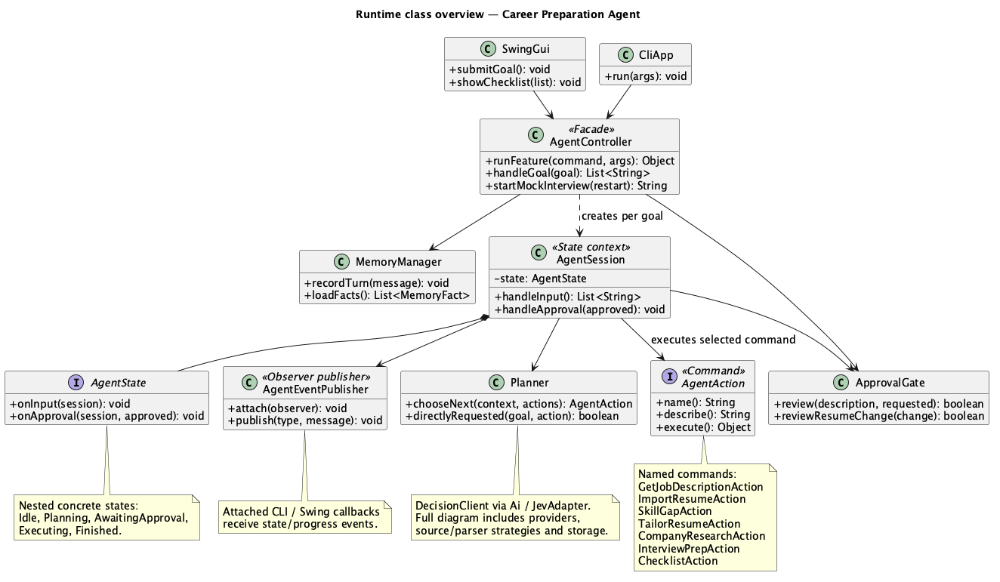
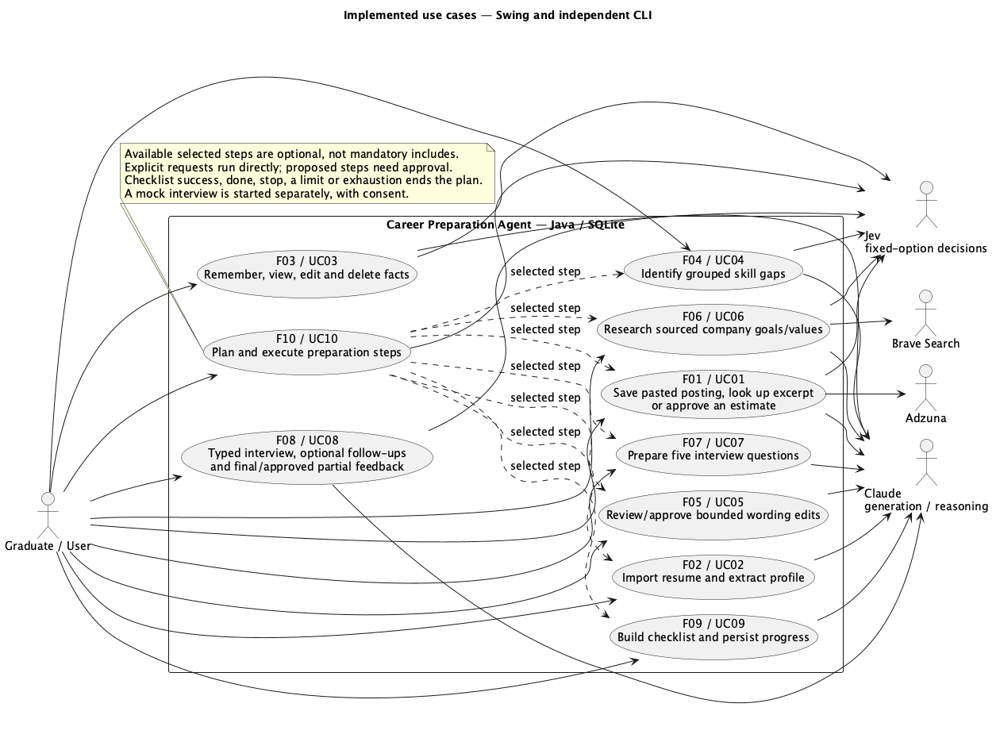
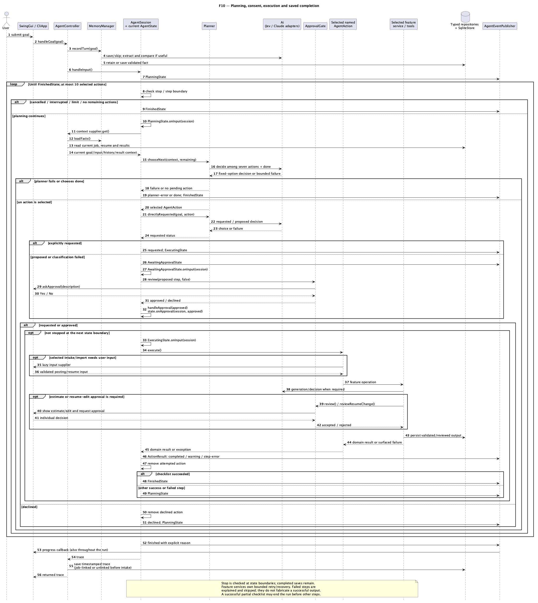

# EECS3311 Stage 2 — Implementation Report

| Report detail | Value |
|---|---|
| Project | Career Preparation AI Agent |
| Author / repository owner | AmirrezaN8 |
| Repository | https://github.com/AmirrezaN8/EECS3311 |
| Prepared | November 15, 2026 — Toronto local time |
| Implementation snapshot | [3cefcf9](https://github.com/AmirrezaN8/EECS3311/commit/3cefcf9311bfa06cbc1e56613c5847837fa30c6e) |

This report describes the current implementation, replacing the earlier accumulated checkpoint narrative. **Final evidence remains incomplete:** development-tool token totals, the exact Jev charge and project-specific subscription allocation remain unreported, video explanations/alternative coverage need resolution, and dependency-backed file parsing remains unverified. The accompanying `stage2-report.pdf` is generated from this editable source; incomplete evidence is explicitly identified.

## 1. Project overview and implementation status

The application helps new graduates applying in Canada and the United States manage job-specific preparation. The ten original Stage 1 features have connected implementation paths: job intake, resume extraction, personal memory, gap analysis, resume tailoring, company research, interview questions, typed interviews, a preparation checklist and goal-driven orchestration. Supporting selection/history/restart/help operations are not counted as additional features.

### Architecture and AI roles

[`SwingGui`](../src/main/java/career/SwingGui.java) and [`CliApp`](../src/main/java/career/CliApp.java) call a shared [`AgentController`](../src/main/java/career/AgentController.java). Feature services coordinate domain validation, AI/tool calls, approvals and four typed SQLite repositories. [`Documents`](../src/main/java/career/Documents.java) maps explicit record types and [`SqliteStore`](../src/main/java/career/SqliteStore.java) executes SQLite transactions through the `sqlite3` executable. Base resumes and approved job-linked versions are separate. GUI operations use a SwingWorker and event-thread dialogs; CLI supports interactive and one-shot commands.

| Responsibility | Actual integration | Configured model |
|---|---|---|
| Constrained choices: memory, skill/source classification, follow-ups and planning | DecisionClient → JevAdapter → JevApi / TypeSafe System One | `jev-latest` |
| Extraction and generation | LLMClient → ClaudeAdapter → AnthropicApi | `claude-haiku-4-5-20251001` |
| Estimates, tailoring, question instructions, feedback and priorities | Same Claude integration, SONNET tier | `claude-sonnet-5-5` |

[`Ai`](../src/main/java/career/Ai.java) coordinates schema validation and one retry per operation. [`PromptBuilder`](../src/main/java/career/PromptBuilder.java) treats supplied content as data and [`ResponseParser`](../src/main/java/career/ResponseParser.java) validates structured output. Adzuna lookup and Brave search run through ToolManager. Production code uses the real configured adapters; canned provider/tool responses are restricted to offline tests. Planner choices, memory retrieval, relevance filtering, follow-up decisions and multi-step execution provide agent behavior beyond forwarding a prompt.

### Build and current evidence

There are 86 production Java source files. The final audit compiled Java 21-compatible code using Temurin JDK 27 on macOS, built a clean tracked snapshot and passed **480 offline assertions**. SQLite and a desktop display are needed for persistence and Swing respectively. The Maven configuration provides JUnit/PDFBox/POI, while the JDK-only build supports DOCX/Markdown/text and explicitly reports unavailable optional libraries. See [README](../README.md) for installation, configuration, launch and example commands.

The author supplied successful provider checks and feature outputs. Ten accessible unlisted videos show actual application use, collectively covering GUI and CLI. These are evidence of the displayed paths, not exhaustive live acceptance. F10 supplied traces establish proposed and explicit-request gap/checklist execution; its uploaded recording independently shows requested gap/checklist execution and completion. Section 7 and [the video index](demo-guide.md) distinguish observed content from unverified alternatives.

### Requirements baseline and limitations

This report uses all five pages of the official *EECS3311 Course Project Stage 2 Instructions — AI Human Collaborative Implementation*, supplied as `Project-Stage2-Instruction (4).pdf`. Its contents match the previously audited copy. [Stage1.md](../Stage1.md) and [uml.uxf](../uml.uxf) remain unchanged from commit e037277. The original UMLet contains class elements; separate implemented use-case/sequence sources are supplied. Differences from Stage 1 are consolidated in section 4.

Remaining limits include unverified Maven/PDF/valid legacy Word runtime paths; conservative skill matching and rewriting; snippet-based research with citation provenance rather than proven entailment; model-dependent intent/relevance judgments; local unencrypted data; and incomplete submission evidence. These limits are not hidden by test fixtures or treated as verified live behavior. No claim of Stage 3 deterministic/KUMA completion is made.

## 2. Feature-to-implementation mapping

Each subsection identifies the original feature/use case, status, implementation files and roles, key methods, collaboration, patterns, evidence and demonstration. Common input/display/persistence infrastructure is introduced above. Source links point to actual files under `src/main/java/career/`.

### F01 — Job Description Intake

**Stage 1 reference:** F01 / UC01. **Type:** Hybrid / agentic.
**Status:** Implemented; pasted intake demonstrated, live lookup/estimate branches not verified.

| Responsibility | Implementing classes/files |
|---|---|
| Command and request | [GetJobDescriptionAction.java](../src/main/java/career/GetJobDescriptionAction.java), [JobDescriptionRequest.java](../src/main/java/career/JobDescriptionRequest.java) |
| Source selection and retrieval | [JobDescriptionIntake.java](../src/main/java/career/JobDescriptionIntake.java), [JobDescriptionSource.java](../src/main/java/career/JobDescriptionSource.java), [PastedTextSource.java](../src/main/java/career/PastedTextSource.java), [AdzunaExcerptSource.java](../src/main/java/career/AdzunaExcerptSource.java), [ExpandedEstimateSource.java](../src/main/java/career/ExpandedEstimateSource.java), [FullEstimateSource.java](../src/main/java/career/FullEstimateSource.java) |
| Tools and storage | [ToolManager.java](../src/main/java/career/ToolManager.java), [AdzunaTool.java](../src/main/java/career/AdzunaTool.java), [SqliteJobRepository.java](../src/main/java/career/SqliteJobRepository.java), [JobDescription.java](../src/main/java/career/JobDescription.java), [SourceLabel.java](../src/main/java/career/SourceLabel.java) |

**Key methods:** `runFeature()`, `execute()`, `getDescription()`, `fetch()`, `label()`, `needsApproval()`, `executeTool()`, `search()`, `saveAndSelect()`.

**Collaboration:** The Job screen or CLI supplies title/company/country and pasted text or a lookup request. PastedTextSource saves an actual supplied posting. With lookup, Adzuna returns excerpts and Jev selects a listing from fixed indices. The user sees the partial-source label and attribution, and must separately approve a Sonnet expanded/full estimate. A declined or failed path retains previous saved work; estimate generation never establishes a verified deadline. Posting selection and save commit together.

**Patterns:** Command, Strategy, Facade, Adapter.

**Verification and limits:** Offline checks exercise lookup selection, attribution, JSON negotiation, bounded retries, approval/rejection, recovery and unchanged prior selection on failure. The recording shows GUI pasted save with USER_PASTED, an explicit deadline and a missing-title validation error. Real Adzuna selection and estimates are not established by this recording.

**Demonstration:** [F01 — 00:00](https://www.youtube.com/watch?v=qXdWoMGQRNM&t=0s)

### F02 — Resume Import and Skill Extraction

**Stage 1 reference:** F02 / UC02. **Type:** Hybrid.
**Status:** Implemented; Markdown/DOCX/text verified, dependency-backed PDF and legacy Word integration pending.

| Responsibility | Implementing classes/files |
|---|---|
| Command, coordinator and factory | [ImportResumeAction.java](../src/main/java/career/ImportResumeAction.java), [ResumeImporter.java](../src/main/java/career/ResumeImporter.java), [ResumeParserFactory.java](../src/main/java/career/ResumeParserFactory.java), [ResumeParser.java](../src/main/java/career/ResumeParser.java) |
| Format strategies | [PdfResumeParser.java](../src/main/java/career/PdfResumeParser.java), [DocxResumeParser.java](../src/main/java/career/DocxResumeParser.java), [DocResumeParser.java](../src/main/java/career/DocResumeParser.java), [MarkdownResumeParser.java](../src/main/java/career/MarkdownResumeParser.java), [PastedTextResumeParser.java](../src/main/java/career/PastedTextResumeParser.java) |
| Profile and persistence | [ResumeProfile.java](../src/main/java/career/ResumeProfile.java), [Skill.java](../src/main/java/career/Skill.java), [SqliteResumeRepository.java](../src/main/java/career/SqliteResumeRepository.java) |

**Key methods:** `importResume()`, `importText()`, `createParser()`, `extractText(String)`, `getSkills()`, `saveAndSelect()`.

**Collaboration:** The file/paste command asks the factory for a format strategy, extracts readable text, and sends it to Haiku. The service validates arrays for skills, education, experience, projects and certifications against literal source phrases. Skill levels remain UNSPECIFIED. Invalid model output retries once, then saves raw input with an explicit warning. Unreadable files offer pasted text; cancellation and failed saves do not silently replace prior selection. Each import is a new base profile; existing bases remain immutable.

**Patterns:** Command, Factory, Strategy, Facade, Adapter.

**Verification and limits:** Offline checks cover DOCX/Markdown/paste, UTF-8, size/file errors, XML external-entity rejection, structured source evidence, retry/raw fallback and preservation. The video shows CLI DOCX and Markdown extraction, a missing-file error and retained profile. PDFBox-backed text/blank/corrupt/protected PDF checks are conditional and were skipped without dependencies. Valid binary .doc extraction has no supplied success fixture.

**Demonstration:** [F02 — 00:00](https://www.youtube.com/watch?v=3hR3z8x4h0c&t=0s)

### F03 — User History Memory

**Stage 1 reference:** F03 / UC03. **Type:** Hybrid.
**Status:** Modified: explicit career-message/goal entry, source-bound facts and model-assisted equivalent-fact checks.

| Responsibility | Implementing classes/files |
|---|---|
| Memory processing and domain | [MemoryManager.java](../src/main/java/career/MemoryManager.java), [MemoryFact.java](../src/main/java/career/MemoryFact.java) |
| Shared UI boundary and storage | [AgentController.java](../src/main/java/career/AgentController.java), [SqliteMemoryRepository.java](../src/main/java/career/SqliteMemoryRepository.java), [AgentEventPublisher.java](../src/main/java/career/AgentEventPublisher.java) |

**Key methods:** `recordTurn()`, `loadFacts()`, `save()`, `editFact()`, `delete()`, `findByText()`, `recordWeakness()`.

**Collaboration:** The chat command, My History message field or submitted goal passes a career message to MemoryManager. Jev decides save/skip. Haiku extracts one source phrase in a permitted category. Normalized duplicates are skipped locally; Jev compares other candidates for conflict, equivalent meaning or compatibility. Conflicts need approval to be saved alongside existing facts. View/edit/delete operations persist directly. Automatic memory errors publish a warning and preserve existing facts. Interview weaknesses use the separate recordWeakness path after feedback is saved.

**Patterns:** Facade, Adapter, Observer.

**Verification and limits:** Offline checks cover skip/save, source/category validation, exact/equivalent duplicates, accepted/rejected conflicts, CRUD/restart and actual SQLite write failure. Supplied Terminal evidence establishes a fresh save, conflict rejection and editing; the video itself shows history, duplicate skipping, invalid-ID validation and approved deletion. Fresh save/conflict rejection are not independently established by the sampled recording. The GUI provides explicit memory and goal entry rather than a general chat transcript, and does not force personal questions when history is empty.

**Demonstration:** [F03 — 00:00](https://www.youtube.com/watch?v=k6f0MA-zz0g&t=0s)

### F04 — Skill-Gap Identification

**Stage 1 reference:** F04 / UC04. **Type:** Hybrid.
**Status:** Implemented with conservative literal-evidence matching.

| Responsibility | Implementing classes/files |
|---|---|
| Command and analysis | [SkillGapAction.java](../src/main/java/career/SkillGapAction.java), [SkillGapService.java](../src/main/java/career/SkillGapService.java) |
| Assessment and presentation | [SkillGapReport.java](../src/main/java/career/SkillGapReport.java), [SkillAssessment.java](../src/main/java/career/SkillAssessment.java), [GapGroup.java](../src/main/java/career/GapGroup.java), [Display.java](../src/main/java/career/Display.java) |
| Linked persistence | [SqliteJobRepository.java](../src/main/java/career/SqliteJobRepository.java) |

**Key methods:** `identify()`, `groupedByPriority()`, `uncertain()`, `format()`, `save()`.

**Collaboration:** Haiku extracts required skill names occurring in the posting. The service normalizes and deduplicates them, then asks Jev to classify each against raw resume evidence. Without a whole-word literal match, the result becomes MISSING and confidence is capped at 0.74, exposing uncertainty rather than treating a substring or synonym as demonstrated evidence. Display shows MISSING, STRONG and DECENT groups in that order, with explicit uncertainty flags. Direct gap requests offer approved recovery for absent job/resume inputs.

**Patterns:** Command, Facade, Adapter.

**Verification and limits:** Offline checks include all groups, normalization, Java/JavaScript and SQL/SQLite boundaries, uncertainty, linked persistence and accepted/declined input recovery. Video shows a real CLI gap invocation, Docker missing, supported skill groups and uncertainty, followed by GUI saved results. Supplied separate Terminal evidence also shows declining missing-job recovery. Synonym matching remains a documented limitation.

**Demonstration:** [F04 — 00:00](https://www.youtube.com/watch?v=O3Qmxmvgtns&t=0s)

### F05 — Resume Tailoring

**Stage 1 reference:** F05 / UC05. **Type:** Hybrid.
**Status:** Modified: bounded wording transformations with deterministic source-token checks and human review.

| Responsibility | Implementing classes/files |
|---|---|
| Command and validation | [TailorResumeAction.java](../src/main/java/career/TailorResumeAction.java), [ResumeTailorService.java](../src/main/java/career/ResumeTailorService.java) |
| Review, result and persistence | [ApprovalGate.java](../src/main/java/career/ApprovalGate.java), [SwingGui.java](../src/main/java/career/SwingGui.java), [ResumeChange.java](../src/main/java/career/ResumeChange.java), [ResumeVersion.java](../src/main/java/career/ResumeVersion.java), [SqliteResumeRepository.java](../src/main/java/career/SqliteResumeRepository.java) |

**Key methods:** `tailor()`, `safeChange()`, `tokens()`, `reviewResumeChange()`, `save(ResumeVersion)`, `findVersions()`.

**Collaboration:** Sonnet proposes up to five unique, non-overlapping source-passage edits and reasons. Validation compares normalized substantive token counts, allowing only specified connective words and a small set of word-form changes. For example, Developed Java applications can become Java application development. CLI prints original/revised/reason; Swing displays read-only original/proposed columns. Each edit requires independent acceptance. Accepted edits form a new job/base-linked version; rejected edits leave their passages unchanged and the base remains intact.

**Patterns:** Command, Facade, Adapter.

**Verification and limits:** Offline checks reject new substantive terms, proficiency claims, changed numeric tokens, negation removal, ambiguous passages and overlap; they verify separate acceptance/rejection, immutable base and restart persistence. The video shows side-by-side approval/reason at 00:34 and an accepted edit at 00:36, plus version/original inspection. Live rejection is not established in the sampled recording. Validation uses the raw source passage rather than a direct getSkills comparison; it rejects broad paraphrases and does not prove semantic equivalence.

**Demonstration:** [F05 — 00:00](https://www.youtube.com/watch?v=WQtftW-NVN8&t=0s)

### F06 — Company Goals and Values Research

**Stage 1 reference:** F06 / UC06. **Type:** Hybrid / agentic.
**Status:** Implemented; sourced Microsoft research demonstrated.

| Responsibility | Implementing classes/files |
|---|---|
| Command and research | [CompanyResearchAction.java](../src/main/java/career/CompanyResearchAction.java), [CompanyResearchService.java](../src/main/java/career/CompanyResearchService.java) |
| Search and results | [WebSearchTool.java](../src/main/java/career/WebSearchTool.java), [ToolManager.java](../src/main/java/career/ToolManager.java), [SearchResult.java](../src/main/java/career/SearchResult.java), [CompanySummary.java](../src/main/java/career/CompanySummary.java), [SqliteJobRepository.java](../src/main/java/career/SqliteJobRepository.java) |

**Key methods:** `research()`, `executeTool()`, `search()`, `decide()`, `cited()`, `save(CompanySummary)`.

**Collaboration:** Haiku creates a company/role/year search query, Brave returns snippets, and Jev labels results relevant/irrelevant. If none remain relevant, Haiku reformulates once and search/filtering repeats. With evidence, Haiku summarizes only supplied snippets. Each goals/values section must cite a supplied URL or say exactly not stated. Missing/invented citations retry once; no relevant sources or a tool error creates no new summary. Previously saved research is preserved on failure.

**Patterns:** Command, Adapter, Facade.

**Verification and limits:** Offline checks cover relevant-only context, bounded reformulation, missing/invented/extended URLs, request encoding, URL boundaries, missing key/outage, restart and previous-summary retention. The video shows CLI Microsoft research with goals/source URLs, not-stated values and GUI retrieval. Citation provenance is checked; factual entailment and relevance quality are not guaranteed, and full web pages are not crawled.

**Demonstration:** [F06 — 00:00](https://www.youtube.com/watch?v=r0O5peysyWs&t=0s)

### F07 — Interview Question Preparation

**Stage 1 reference:** F07 / UC07. **Type:** AI-based.
**Status:** Implemented with a fixed five-question set.

| Responsibility | Implementing classes/files |
|---|---|
| Command and two-stage generation | [InterviewPrepAction.java](../src/main/java/career/InterviewPrepAction.java), [InterviewPrepService.java](../src/main/java/career/InterviewPrepService.java) |
| Question storage and consent | [InterviewQuestion.java](../src/main/java/career/InterviewQuestion.java), [InterviewQuestionSet.java](../src/main/java/career/InterviewQuestionSet.java), [SqliteJobRepository.java](../src/main/java/career/SqliteJobRepository.java), [AgentController.java](../src/main/java/career/AgentController.java), [ApprovalGate.java](../src/main/java/career/ApprovalGate.java) |

**Key methods:** `prepare()`, `saveQuestions()`, `findQuestions()`, `review()`, `startMockInterview()`.

**Collaboration:** The service loads job, profile, available company evidence and memory. Sonnet writes tailored generation instructions; Haiku receives those instructions and the same full context. Exactly five nonblank, normalized-distinct strings are required. Questions receive unique IDs, job links and empty answers, and are saved only after validation. Direct GUI/CLI generation separately offers to start or continue a mock interview. Declining retains the saved questions. Prepared-set regeneration does not replace an existing interview session snapshot.

**Patterns:** Command, Adapter, Facade.

**Verification and limits:** Offline checks verify tier ordering/context, count/type/duplicate/empty failures, one retry, prior-set preservation, restart and both consent outcomes. The video shows question generation, a mock-interview consent dialog at 00:28, five questions and reopened saved output. Semantic question distinctness and personalization quality still require human judgment.

**Demonstration:** [F07 — 00:00](https://www.youtube.com/watch?v=q5oq_tFzdRQ&t=0s)

### F08 — Mock Interview with Answer Feedback

**Stage 1 reference:** F08 / UC08. **Type:** AI-based / agentic.
**Status:** Implemented; typed progression and final feedback demonstrated.

| Responsibility | Implementing classes/files |
|---|---|
| Interview orchestration and domain | [AgentController.java](../src/main/java/career/AgentController.java), [MockInterviewService.java](../src/main/java/career/MockInterviewService.java), [InterviewSession.java](../src/main/java/career/InterviewSession.java), [InterviewQuestion.java](../src/main/java/career/InterviewQuestion.java), [FeedbackReport.java](../src/main/java/career/FeedbackReport.java) |
| Progress, reports and weakness memory | [SqliteJobRepository.java](../src/main/java/career/SqliteJobRepository.java), [MemoryManager.java](../src/main/java/career/MemoryManager.java) |

**Key methods:** `start()`, `nextQuestion()`, `answer()`, `stop()`, `feedback()`, `restartInterview()`, `recordWeakness()`.

**Collaboration:** Start/continue reads the saved interview or snapshots prepared questions. Each base answer is saved before Jev chooses next/followup. At most one Haiku clarification is stored for each base question. Normal progression returns questions without feedback. The facade automatically generates Sonnet feedback after completion; its per-answer count must match answered base questions. Stop retains progress and separately offers partial feedback. New attempt archives previous progress/report. Weakness-memory failure warns without hiding the already-saved feedback.

**Patterns:** Facade, Adapter; the separate preparation workflow uses State.

**Verification and limits:** Offline checks include follow-up bound, no premature evaluation, blank answers, resume after restart/outage, automatic completion feedback, approved/declined partial feedback, invalid-count retention, archive and SQLite weakness-write failure. The recording shows a new attempt, answers and final feedback/weaknesses. Optional follow-ups, pause/resume and partial-feedback approval are not established by its sampled footage. Placeholder answers demonstrate operation, not interview competence.

**Demonstration:** [F08 — 00:00](https://www.youtube.com/watch?v=PTBeonTQZ9A&t=0s)

### F09 — Preparation Checklist

**Stage 1 reference:** F09 / UC09. **Type:** Hybrid.
**Status:** Implemented with explicit supported-date parsing and a deterministic ordering fallback.

| Responsibility | Implementing classes/files |
|---|---|
| Command and task derivation | [ChecklistAction.java](../src/main/java/career/ChecklistAction.java), [ChecklistService.java](../src/main/java/career/ChecklistService.java) |
| Deadline, progress and storage | [JobDescriptionIntake.java](../src/main/java/career/JobDescriptionIntake.java), [Checklist.java](../src/main/java/career/Checklist.java), [ChecklistItem.java](../src/main/java/career/ChecklistItem.java), [SqliteChecklistRepository.java](../src/main/java/career/SqliteChecklistRepository.java), [SwingGui.java](../src/main/java/career/SwingGui.java), [Display.java](../src/main/java/career/Display.java) |

**Key methods:** `build()`, `tick()`, `progress()`, `showChecklist()`, `explicitDeadline()`, `findById()`.

**Collaboration:** The service derives tasks from accepted tailoring status, posting deadline, non-strong gap assessments, questions and company research. Sonnet orders an unchanged label set; invalid/unavailable ordering retains the deterministic sequence. Direct building offers missing work with approval and refreshes labels after successful related work. Initial checklist show builds a list; later show retrieves it. Unchanged labels keep stable IDs and ticks on rebuild. Tick/untick persists integer progress; Swing has checkboxes and a percentage bar.

**Patterns:** Command, Facade, Adapter.

**Verification and limits:** Offline checks cover partial/full inputs, explicit ISO/English month dates, invalid/ambiguous/conflicting dates, task priority, AI tier, tick/untick/restart, unchanged-ID rebuild and approved-work refresh. Video shows a partial-checklist consent dialog, tasks/deadline, ticks/progress and a retained tick after reopening. Later rebuild preservation is not established by its sampled recording. A changed task label creates a new task; ambiguous deadlines are not automatically added.

**Demonstration:** [F09 — 00:00](https://www.youtube.com/watch?v=mvviBAHe5yw&t=0s)

### F10 — Prepare Me For This Job

**Stage 1 reference:** F10 / UC10. **Type:** Hybrid / agentic.
**Status:** Implemented; proposed/direct-request traces supplied, uploaded GUI demonstration reviewed.

| Responsibility | Implementing classes/files |
|---|---|
| Facade and selection | [AgentController.java](../src/main/java/career/AgentController.java), [Planner.java](../src/main/java/career/Planner.java), [AgentAction.java](../src/main/java/career/AgentAction.java) |
| Runtime state, outcomes and progress | [AgentSession.java](../src/main/java/career/AgentSession.java), [ActionResult.java](../src/main/java/career/ActionResult.java), [ApprovalGate.java](../src/main/java/career/ApprovalGate.java), [AgentEventPublisher.java](../src/main/java/career/AgentEventPublisher.java) |
| Executable work | GetJobDescriptionAction, ImportResumeAction, SkillGapAction, TailorResumeAction, CompanyResearchAction, InterviewPrepAction and ChecklistAction (linked in the features above). |

**Key methods:** `handleGoal()`, `chooseNext()`, `directlyRequested()`, `handleInput()`, `handleApproval()`, `onInput()`, `onApproval()`, `execute()`, `publish()`, `saveTrace()`.

**Collaboration:** The submitted goal is considered for memory. Each planning step rereads the selected job/profile, history and saved outputs. Jev chooses description, import, gap, tailor, company, interview prep, checklist or done. Intake/import collect input lazily within the plan. A separate Jev decision distinguishes explicitly requested work from proposed work; proposed work requires approval, while classification failure falls back to asking approval. Feature-specific estimate/edit approvals remain. State transitions publish progress; failed or declined actions are explained and removed from that run. Successful checklist, done, no remaining actions, ten selected steps, planner failure or stop ends the workflow with an explicit reason. A timestamped trace is saved, linked to a selected job or unlinked before intake.

**Patterns:** Facade, Command, State, Observer, Adapter.

**Verification and limits:** Offline checks cover the complete option set, done, early checklist, requested/proposed consent, failure fallback, invalid-state approval, stop, cap, empty-database planned intake/import and linked/unlinked traces. Supplied live traces show generic goals using approval and explicit gap/checklist requests executing directly, ending with Checklist produced. The uploaded GUI recording shows requested gap/checklist execution, Checklist produced at 00:21 and checklist output at 00:29. Live done/cancellation/rejection branches are not independently established. Intent classification remains model-dependent; a run may legitimately end with a partial checklist.

**Demonstration:** [F10 — 00:00](https://www.youtube.com/watch?v=NZzGRP7kGIw&t=0s)

## 3. Implemented design patterns

Seven distinct Stage 1 pattern roles participate in actual execution. A repeated use of a pattern is not counted twice. The parser factory is a concrete selection factory; the other roles follow the interfaces and interactions described below.

| Pattern and design problem | Participants, roles and methods | Implementation and Stage 1 relationship |
|---|---|---|
| Facade — keep UI clients independent of subsystem coordination | [AgentController.java](../src/main/java/career/AgentController.java): runFeature(), handleGoal(), startMockInterview(); [SwingGui.java](../src/main/java/career/SwingGui.java) and [CliApp.java](../src/main/java/career/CliApp.java) are clients | Both entry points invoke shared services, approval and persistence through the controller. Role matches Stage 1; the facade returns domain results for display. |
| Command — select heterogeneous preparation work through one execution interface | [AgentAction.java](../src/main/java/career/AgentAction.java) defines name()/describe()/execute(); GetJobDescriptionAction, ImportResumeAction, SkillGapAction, TailorResumeAction, CompanyResearchAction, InterviewPrepAction and ChecklistAction are concrete commands | Planner selects an AgentAction; ExecutingState invokes execute(). Inputs are supplied through constructors/lazy suppliers. The legacy FeatureCommand record supports fixtures/compatibility, not production preparation registration. |
| Strategy — vary source/format behavior without rewriting coordination | [JobDescriptionSource.java](../src/main/java/career/JobDescriptionSource.java): fetch()/label()/needsApproval(); [ResumeParser.java](../src/main/java/career/ResumeParser.java): extractText(String) | Four source strategies and format-specific parser strategies perform real retrieval/extraction. Intake/importer use their common contracts, preserving the Stage 1 roles. Legacy DocResumeParser supports the Word-format scope. |
| Factory — centralize concrete parser construction | [ResumeParserFactory.java](../src/main/java/career/ResumeParserFactory.java): createParser(Path/String); ResumeImporter is its client | A switch selects PDF, DOCX, DOC, Markdown/text or pasted strategy and returns ResumeParser. Format selection remains outside the importer. This preserves the planned factory responsibility. |
| State — make planning, consent, execution and termination stage-specific | [AgentSession.java](../src/main/java/career/AgentSession.java): AgentState plus IdleState, PlanningState, AwaitingApprovalState, ExecutingState, FinishedState; handleInput(), handleApproval(), onInput(), onApproval(), setState() | Planning selects work; AwaitingApproval owns consent; Executing records an ActionResult; Finished publishes the outcome. The loop is bounded. Roles match Stage 1; nested types and shared synchronous callbacks are representation choices. |
| Observer — report progress without coupling services to widgets | [AgentEventPublisher.java](../src/main/java/career/AgentEventPublisher.java): AgentEvent, ProgressObserver, attach()/detach()/publish(); CLI/GUI register callbacks | AgentSession and MemoryManager publish transitions/warnings. Swing callbacks schedule event-thread updates; CLI prints events. Observer RuntimeExceptions do not abort saved work. publish() performs the notifyObservers role from Stage 1. |
| Adapter — isolate vendor contracts from application interfaces | [JevAdapter.java](../src/main/java/career/JevAdapter.java) implements DecisionClient using JevApi; [ClaudeAdapter.java](../src/main/java/career/ClaudeAdapter.java) implements LLMClient using AnthropicApi | Adapters translate requests/responses and validate provider envelopes/options. Ai delegates to these distinct boundaries and coordinates retries. The planned Jev/Claude separation is preserved. |

### Current implementation diagrams

The compact class overview shows the shared facade and active planning, command, state, consent and observer roles. Selected methods are shown; it is not an exhaustive class listing.

The [full class diagram (SVG)](implemented-class-diagram.svg) adds providers, all seven named commands, source/parser strategies, repositories and domain relationships. Open the SVG to zoom, or use its [PNG](implemented-class-diagram.png). Editable sources are supplied for the [overview](implemented-class-overview.puml) and [full class diagram](implemented-class-diagram.puml).

[Use-case SVG](implemented-use-cases.svg) · [editable source](implemented-use-cases.puml). F05 shows bounded wording edits. F10 selects optional steps rather than requiring every feature; mock interviews retain separate consent.

[Sequence SVG for zooming](implemented-sequence.svg) · [editable source](implemented-sequence.puml). The sequence reflects lazy intake/import, requested versus proposed work, onInput/onApproval, done, cancellation, failed steps and persisted traces. It summarizes feature service internals rather than reproducing every provider call.

Rendered with PlantUML 1.2026.10, headless Java and embedded Smetana layout. Original Stage 1 files remain unchanged. The PDF incorporates these current images. The detailed class SVG remains a zoomable companion; the F10 sequence spans two wide sheets to retain readable labels. Regenerate from the repository root with `python3 scripts/report.py` (Python 3 and Chrome/Chromium required).

## 4. Changes and rationale

Changes below compare the original Stage 1 design with the current code, using Original design → Implemented change → Reason → Impact. Transient implementation experiments are not presented as the submitted architecture. The same ten user-facing features and seven intended pattern roles remain; supporting commands are not counted as extra features.

| Original design / affected requirement | Implemented change | Reason | Impact, affected code/use cases/patterns |
|---|---|---|---|
| Resume-tailoring wording improvement and skill validation | Bounded word-form/connective changes with source-passage token checks rather than unrestricted rewriting or a direct profile.getSkills() comparison | Provide deterministic rejection of new substantive vocabulary and numeric-token changes while allowing real wording improvements | F05 / UC05: ResumeTailorService.safeChange()/tokens(), ResumeChange/ResumeVersion, ApprovalGate/SwingGui. Broader valid paraphrases may be rejected; human review is still required. Command/Facade roles preserved. |
| Resume structuring and personal-fact summarization | Extract literal source phrases; fact categories and all structured resume sections are validated | Avoid saving unsupported qualifications or personal assertions | F02/F03 / UC02/UC03: ResumeImporter, MemoryManager, Ai/ResponseParser. Retries/fallback preserve raw input or prior memory; paraphrase flexibility is reduced. Factory/Strategy/Adapter remain. |
| Chat-turn memory and questions when history is empty | Explicit CLI chat, My History career-message field and submitted goals trigger memory; no forced personal-history interview or general chat transcript | Keep career fact entry and review explicit within the Swing/CLI interface | F03/F10 / UC03/UC10: AgentController.handleGoal()/runFeature(), MemoryManager, SwingGui. Empty history is still passed to planning; the original automatic empty-history questioning is not implemented. Facade/Observer roles remain. |
| Separate preparation views in Stage 1 descriptions | Gap, tailoring, company and question actions share the Preparation tab; history/interview/checklist remain separate | Reuse shared results, progress and approval surfaces | F04–F07/F10: SwingGui.preparation()/run(); major operations remain accessible. Layout differs; no feature replacement is claimed. |
| Integer IDs, mutable-style entities, JDBC Connection fields and Date in UML | Typed records with UUID string IDs, Instant/LocalDate, four repositories and native sqlite3 transport | Use the installed platform database tool with explicit entity links and Java value types | Persistence for F01–F10: Documents, SqliteStore and repositories. MacOS tested; sqlite3 is an external prerequisite. Compatibility reads retain legacy records. No JDBC implementation is claimed. |
| AgentAction.execute(context) and facade ActionResult signatures | Concrete commands return typed domain results through Object at the common boundary; AgentSession uses ActionResult(success,message) for execution status | Let shared UI rendering consume real feature results while keeping uniform command execution | F01/F02/F04–F07/F09/F10: named actions, AgentController, AgentSession. Command/Facade responsibilities preserved; updated diagram signatures reflect actual methods. |
| State/observer types drawn as individual UML classes; Planner shows a maxSteps field | State/event/approval roles use nested Java types and callbacks; AgentSession enforces ten selected steps | Keep transition, consent and bound enforcement in the active session | F10 / UC10: AgentSession, AgentEventPublisher and ApprovalGate. onInput/onApproval remain state-owned; publish() is the notification method. Seven named actions plus done are available without forcing checklist last. |
| Posting deadline included when supplied | Strict explicitly labeled ISO/English-month parsing; ambiguous numeric and conflicting dates are not inferred | Avoid inventing a deadline while supporting common unambiguous posting dates | F01/F09 / UC01/UC09: JobDescriptionIntake.explicitDeadline(), JobDescriptionRequest and ChecklistService. Unsupported dates remain in source text for manual interpretation; estimates cannot establish a deadline. |
| AI-prioritized checklist from preparation data | Validate an unchanged label permutation, retain deterministic priority order if AI fails, refresh after approved work | Keep useful partial preparation available during provider failure without manufacturing an AI result | F09 / UC09: ChecklistService.build(), AgentController.offerMissingSteps(), ChecklistAction. Existing matching task IDs/ticks persist; changed labels become new tasks. |
| Resume import covers Word/PDF and mock interviews retain progress | POI/PDFBox handle optional binary formats; interview sessions snapshot prepared questions and archive old attempts | Reuse established parsers and preserve original/resumable data | F02/F07/F08: parser strategies, InterviewSession and repositories. Packaged parser integration is still unverified. Regenerating prepared questions does not replace the current interview; New attempt selects a fresh set. |
| Stage 1 refers to use-case/sequence diagrams in uml.uxf | Separate PlantUML sources accompany the unchanged original UMLet file | Keep original design evidence and make implementation diagrams independently editable | Report/traceability artifacts: implemented-class-diagram.puml, implemented-use-cases.puml, implemented-sequence.puml. Current PNG/SVG renderings and a compact class overview accompany the reconciled sources. |

## 5. AI tools and collaboration log

### Development tools and author-reported accounting

The major AI development tool was **OpenAI Codex**, identified by the environment as based on the **GPT-6 family**. The author reports using a regular **$20/month ChatGPT subscription** to build the project. An exact serving model variant, project token total and project-specific subscription allocation have not been supplied. A subscription payment is recorded separately from metered application API usage.

The development assistant read requirements/source, implemented and revised code, wrote offline fixtures, investigated reported failures, and prepared documentation. The author supplied requirements, configured private credentials, ran live application checks, provided outputs/recordings, reviewed decisions and controlled publication.

| Tool / model | Development tasks | Total tokens | Monetary cost and basis |
|---|---|---|---|
| OpenAI Codex — GPT-6-family identification; exact serving model unconfirmed | F01–F10 implementation and correction; API/repository integration; tests; debugging; UML/report/README preparation | **Not supplied — project/session token total unavailable in the evidence provided** | **$20/month ChatGPT subscription**, author-reported as used for development; no separate metered Codex charge or project allocation supplied |

### Application-model and external-tool usage

The following costs, request counts and token totals were supplied by the author on November 15, 2026. They are author-reported usage figures, not independently inspected invoices. Dollar amounts are retained as reported; currency code and tax treatment were not specified.

| Configured models/tool | Implemented runtime responsibility | Author-reported requests / tokens | Author-reported monetary usage |
|---|---|---|---|
| Claude Haiku 4.5 (`claude-haiku-4-5-20251001`) and Sonnet 5.5 (`claude-sonnet-5-5`) | Haiku: extraction, company queries/summaries, questions and optional clarifications. Sonnet: estimates, tailoring, question instructions, feedback and priorities | **26,837 input + 14,053 output = 40,890 total tokens** across Claude; request count and per-model split not supplied | **$0.16 combined Claude usage**; no Haiku/Sonnet breakdown supplied. This is one combined total, not $0.16 per model |
| Jev (`jev-latest`) | Fixed-option memory, equivalence/conflict, gap/relevance/follow-up and planner/request decisions | **53 requests; 27,043 total tokens**; input/output split not supplied | Described as very low usage; balance display still reads **$5/$5 available**. Exact charge is unknown at that display precision and is **not recorded as zero** |
| Brave Search | F06 live search snippets | **3 requests**; token count not applicable to the search API | **$0.01** |
| Adzuna | F01 lookup excerpts | Not applicable to the lookup API | No usage/cost figure supplied; no live lookup success established in the submitted evidence |

**Known reported metered subtotal: $0.17 = $0.16 Claude + $0.01 Brave**, excluding the unknown Jev amount. The **$20/month subscription is a separate recurring expense**, not an inferred per-project API charge. An exact all-in project cost cannot be calculated from the rounded Jev balance and an unallocated subscription.

**Reported application-model token total: 67,933 = 40,890 Claude + 27,043 Jev.** This excludes development-tool usage and does not assign tokens to Brave/Adzuna. The supplied provider figures are treated as project usage reported by the author; they have not been independently matched to a billing export.

Development-tool project/session tokens remain unreported, not zero. Claude request count, per-model allocation and Jev input/output split were not supplied. No missing values are inferred from dollar costs, source size, commits or assertion counts. The tools available in this session do not expose historical project/session token totals or billing exports. Those values cannot be recovered here; this is a documented accounting limitation.

Offline verification makes no real provider calls, even if local credentials exist. The final audit used local compilation/SQLite checks and anonymous YouTube retrieval, not paid model calls. This does not imply zero usage for the author's separate live application runs or development subscription.

### Representative recorded collaboration

| Date / evidence | Human–AI task and review | Concrete result |
|---|---|---|
| Nov 14 — initial source/API/repository commits | Restore the Stage 1 Jev/Claude boundaries, typed domain repositories and usable intake/import slice | Commits 99ca4c9 and 9dca841; API/domain/input fixtures and sample walkthroughs |
| Nov 14 — [F01/F02 checkpoint evidence](checkpoint-3-inputs.md) | Author reported Invalid JSON number with raw-only extraction. A valid fenced-JSON fixture reproduced that parser failure; bounded wrapper handling and retry diagnostics were corrected | Successful subsequent author Markdown/DOCX extraction with empty warnings. Original live response was not captured, so its precise failure format remains unconfirmed |
| Nov 15 — [memory evidence](checkpoint-4-memory.md) | Author showed know Java and SQL versus I know Java and SQL as duplicate records; a target-role message was also wrongly skipped | Jev equivalence comparison and explicit career-intention criteria added; source/category validation and preservation checks retained |
| Nov 15 — [gap](checkpoint-5-gap.md) and [tailoring](checkpoint-5-tailoring.md) | Review found missing grouped/uncertainty presentation and permutation-only rewriting | Ordered/uncertain display, whole-word evidence, bounded wording improvement and side-by-side per-edit review; author supplied working outputs |
| Nov 15 — [research](checkpoint-6-company.md) and [question preparation](checkpoint-6-questions.md) | Author supplied a missing Brave key error followed by sourced results; generation context and citation validation were reviewed | CompanyResearchAction, citation provenance checks, InterviewPrepAction and shared full context to both generation stages |
| Nov 15 — [interview](checkpoint-7-interview.md) and [checklist](checkpoint-8-checklist.md) | Complete automatic final feedback, isolate weakness-write failures and preserve/refresh checklist progress | Commits 642b229 and c0fbb75, with fault-injected offline checks and author walkthroughs |
| Nov 15 — [agent checkpoint](checkpoint-9-agent.md) | Restore the complete planner list/done, requested/proposed consent and state-owned transitions; author supplied both generic and explicit-request traces | Commit 3cefcf9; 480-assertion suite and saved partial-checklist evidence |
| Nov 15 — final submission audit and documentation | Author required read-only audit followed by one approved task at a time; supplied playlist and confirmed its oldest-to-newest F01–F09 ordering | Clean snapshot checks, nine real demo links, current README navigation and this reconciled report; F10 upload/cost/diagram/package gaps kept explicit |

The assistant's output was reviewed through source inspection, fixtures, deterministic validators, fault-injected storage failures and author live walkthroughs. These checks reduce implementation risk; they do not replace the author's responsibility to understand and validate submitted code.

## 6. Development and verification summary

### Actual Git history and weekly requirement

The local repository has a complete, non-shallow history with ten commits at this implementation snapshot. Dates below are author timestamps converted to Toronto local time; author and committer dates in the inspected history agree. The final audit's read-only remote check found GitHub main at the same implementation commit 3cefcf9; its public repository was accessible. Later documentation edits in this working tree are not represented as already committed or pushed.

| Commit | Toronto date/time | Actual change |
|---|---|---|
| [10360c8](https://github.com/AmirrezaN8/EECS3311/commit/10360c8933d50cd92fe7bb4cd1f54d7a85513af2) | 2026-10-05 16:30 EDT | Initial commit |
| [e037277](https://github.com/AmirrezaN8/EECS3311/commit/e0372776f763eb4959d374fb3680fa533608cd2b) | 2026-10-05 16:46 EDT | stage 1 project plan and uml in .uxf format built with umlet in eclipse |
| [99ca4c9](https://github.com/AmirrezaN8/EECS3311/commit/99ca4c9c215b2fb2b18c338d33f84f19da38f044) | 2026-11-14 17:49 EST | feat: add Java core with Jev and Claude adapters and typed SQLite repositories |
| [9dca841](https://github.com/AmirrezaN8/EECS3311/commit/9dca841f79c41957b73fd23ec149c2808447066a) | 2026-11-14 18:52 EST | feat: restore job intake and resume import with validated AI output |
| [cfe23e8](https://github.com/AmirrezaN8/EECS3311/commit/cfe23e8d561fbabc452403eb3e3dd1b0b02f7dd7) | 2026-11-15 00:42 EST | feat: improve career memory, skill gaps and resume tailoring |
| [8ca6813](https://github.com/AmirrezaN8/EECS3311/commit/8ca681332c5126ffec8716ffb95f9b800735bb4a) | 2026-11-15 00:57 EST | feat: validate sourced company research and restore its command |
| [e5bc049](https://github.com/AmirrezaN8/EECS3311/commit/e5bc0497ccf7f0552c3297ad14d8d21062024ef9) | 2026-11-15 01:02 EST | feat: ground interview questions in company evidence and history |
| [642b229](https://github.com/AmirrezaN8/EECS3311/commit/642b229bcf34fe6085d0214b6dee32596758a03c) | 2026-11-15 01:22 EST | feat: complete mock interviews with automatic final feedback |
| [c0fbb75](https://github.com/AmirrezaN8/EECS3311/commit/c0fbb75bf0a03021bd1b12c60bac1d089880b9a8) | 2026-11-15 01:28 EST | feat: complete prioritized checklists with persistent progress |
| [3cefcf9](https://github.com/AmirrezaN8/EECS3311/commit/3cefcf9311bfa06cbc1e56613c5847837fa30c6e) | 2026-11-15 01:43 EST | feat: restore full preparation planner and approval states |

| Required reporting period (Toronto, inclusive) | Minimum meaningful code commits | Found | Result |
|---|---:|---:|---|
| 2026-10-20–2026-10-26 | 5 | 0 | NOT MET |
| 2026-10-27–2026-11-02 | 5 | 0 | NOT MET |
| 2026-11-03–2026-11-09 | 5 | 0 | NOT MET |

There are no qualifying commits within those windows to link. The eight implementation/test commits are dated November 14–15, outside the required periods; the October 5 commits are repository/Stage 1 work. Extra later commits do not compensate. The official Stage 2 instructions specify **one five-point deduction in total** if any period misses its minimum, not five points per period or missing commit. No history is backdated, fabricated or rewritten.

### Checks actually performed

| Check and evidence | Result and practical limit |
|---|---|
| Clean tracked snapshot: sh scripts/build.sh | PASS — Java 21-compatible production/test compilation, executable JAR and 480 offline assertions. No ignored local career.properties was required in the snapshot. |
| Offline suite groups | 79 API/response assertions, 79 domain/repository assertions, 74 F01/F02 assertions and other service/facade/workflow checks form the 480 total. These are assertions, not 480 separately named test cases. |
| Provider/tool boundary fixtures | PASS — intercepted request/envelope/auth/model routing, strict options/probabilities, malformed output, bounded retry and source/context checks. These are not real service-connectivity claims. |
| Persistence/failure checks | PASS — UTF-8, relationships, immutable bases, transactions/restart, IDs/ticks, archived interviews, rollback/failure preservation and real SQLite trigger-injected write failures. Databases were disposable. |
| Independent CLI audit | PASS — help and separate processes saving/reloading a fictional posting, source label and explicitly written deadline. |
| Headless Swing audit | PASS — clear desktop-display requirement and graceful exit. It is not an interactive desktop acceptance test. |
| Author live evidence | Provider connectivity checks, Terminal feature outputs, F10 traces and ten actual GUI/CLI recordings. Each claim is limited to the supplied output/observed footage. |
| Demonstration access | Ten unlisted F01–F10 clips retrieved without account cookies/login; real screen footage sampled and brief review dialogs inspected. F10 requested-action trace and checklist output inspected at 00:21/00:29. |
| Audio/explanation review | F01–F09 complete downloaded audio tracks had mean/max approximately -91 dB; F10 approximately -90.3 dB; no available uploaded/automatic captions. Video explanation/ID requirements are not fully established from titles/descriptions alone. |
| Credential protection | No known-local-key/high-confidence secret matches in 215 unique historical Git blobs; no career.properties, personal database or target artifacts tracked. Local key-file permissions were 0600. This is scoped scanning, not exhaustive security certification. |
| Original design preservation | Stage1.md and uml.uxf match the Stage 1 baseline; no destructive replacement. |
| Documentation checks | Existing relative links, ten feature/video mappings, README shell syntax/configuration fields and git diff --check pass. This editable report is checked against current file/method paths; PDF generation is separate. |

### Important defects corrected

- JSON parsing originally changed representable integer output and misreported some non-JSON prefixes. Integer form, strict value diagnostics, bounded fenced-object handling and actual retry validation errors now have regression checks.
- Memory could save equivalent wording twice or skip a useful target-role intention. Normalized checks, Jev equivalence/conflict choices and clearer save criteria address the observed failures; model-dependent limits remain.
- Gap output lacked required groups/uncertainty, and substring matches could overstate evidence. Shared display and whole-word validation now cover direct/saved results.
- Tailoring only shuffled identical words. Bounded word forms permit genuine improvements with overlap/source validation and independent GUI/CLI review, while broad rewriting remains restricted.
- Completed interviews required a separate feedback request, and weakness-write failure could hide a saved report. Completion now returns feedback automatically; memory failure warns independently. Saved answers also survive a follow-up-decision outage.
- Initial checklist retrieval and post-approved-work labels could remain stale. First show builds; successful related work refreshes; unchanged task identity/progress is preserved.
- Planner lacked the full action set/done and forced approvals/checklist ordering. All named actions now participate, explicit requests bypass redundant step consent, state callbacks own approval, and every terminal path has a finish reason and saved trace.

### Remaining verification and submission work

1. Accounting limitation documented: historical development-tool tokens and exact serving-model/project billing data are unavailable through the current session tools. Runtime usage is recorded: Claude 26,837 input/14,053 output tokens ($0.16 combined), Jev 53 requests/27,043 tokens (exact charge unknown) and Brave 3 requests ($0.01). Preserve the separate $20/month development subscription; do not infer zero Jev cost from its rounded balance.
2. Resolve the ten recordings' explanation/feature-ID and relevant coverage gaps; F10 upload/link/access are now verified without assuming every source branch is demonstrated.
3. Regenerate the PDF again if remaining evidence or video links are supplied before submission.
4. Verify Maven/JUnit packaging, PDFBox extraction and a valid legacy .doc sample. Do not count skipped parser checks as successful integrations.
5. Retain honest limits for Adzuna/estimate live paths, semantic/model quality and unobserved cancellation/rejection/partial-feedback alternatives.
6. Review final source/report/README consistency and secrets, commit/push final artifacts only with authorization, recheck public access and submit the repository URL through the course system with author approval. The supplied PDF states November 10, 2026 as the due date; no extension was supplied in the audited materials.

Only Stage 2 implementation and basic verification are claimed. Stage 3 deterministic testing and KUMA agent validation are separate obligations.

## 7. Demonstration index

Playlist: [EECS3311demos](https://www.youtube.com/playlist?list=PLWFiN1jmW3sI). The author confirms oldest-to-newest uploads correspond to F01–F09. Ten unlisted videos were accessed without signing in on November 15, 2026. Each is a dedicated feature clip, so its direct 00:00 link covers that feature recording. The newly added 39-second F10 recording shows explicitly requested gap/checklist execution and checklist output.

| Feature | Direct video / start | Interface observed | Evidence scope |
|---|---|---|---|
| F01 — Job Description Intake | [F01 — 00:00](https://www.youtube.com/watch?v=qXdWoMGQRNM&t=0s) | GUI | Pasted save/source/deadline and missing-title validation |
| F02 — Resume Import and Skill Extraction | [F02 — 00:00](https://www.youtube.com/watch?v=3hR3z8x4h0c&t=0s) | CLI | DOCX/Markdown extraction, missing-file recovery |
| F03 — User History Memory | [F03 — 00:00](https://www.youtube.com/watch?v=k6f0MA-zz0g&t=0s) | GUI; prior CLI output | History, duplicate skip, ID validation and deletion |
| F04 — Skill-Gap Identification | [F04 — 00:00](https://www.youtube.com/watch?v=O3Qmxmvgtns&t=0s) | CLI and GUI | Required groups/uncertainty and saved output |
| F05 — Resume Tailoring | [F05 — 00:00](https://www.youtube.com/watch?v=WQtftW-NVN8&t=0s) | GUI | Side-by-side approval, accepted version and preserved base |
| F06 — Company Goals and Values Research | [F06 — 00:00](https://www.youtube.com/watch?v=r0O5peysyWs&t=0s) | CLI and GUI | Sourced Microsoft goals, not-stated values and retrieval |
| F07 — Interview Question Preparation | [F07 — 00:00](https://www.youtube.com/watch?v=q5oq_tFzdRQ&t=0s) | GUI; prior CLI output | Five questions, separate consent and reopened output |
| F08 — Mock Interview with Answer Feedback | [F08 — 00:00](https://www.youtube.com/watch?v=PTBeonTQZ9A&t=0s) | GUI | Typed progression and final evaluation |
| F09 — Preparation Checklist | [F09 — 00:00](https://www.youtube.com/watch?v=mvviBAHe5yw&t=0s) | GUI | Partial list/consent, progress and retained tick |
| F10 — Prepare Me For This Job | [F10 — 00:00](https://www.youtube.com/watch?v=NZzGRP7kGIw&t=0s) | GUI | Requested gap/checklist trace at 00:21; Checklist produced and checklist output at 00:29 |

F05 original/proposed/reason review is directly visible at [00:34](https://www.youtube.com/watch?v=WQtftW-NVN8&t=34s); F07 separate mock-interview consent at [00:28](https://www.youtube.com/watch?v=q5oq_tFzdRQ&t=28s). Collectively, the footage shows both required interfaces running the application. Sampled frames are not an exhaustive frame-by-frame or audio-narration review; whole-audio analysis establishes effectively silent tracks. No API keys were identified in inspected frames, but the author should check original recordings before submission.

**Explanation/coverage limit:** titles/descriptions and live application screens do not by themselves certify every required feature-ID, purpose/AI explanation or relevant alternative path. All ten tracks are effectively silent and have no available captions. F10 also retains a generic screen-recording title and empty description. The author accepts the existing title and description; no metadata changes are planned. The observed explanation/coverage limits remain disclosed. [docs/demo-guide.md](demo-guide.md) records exact observed scope and unverified branches. No video link, timestamp, behavior, usage figure or completion status has been invented.
